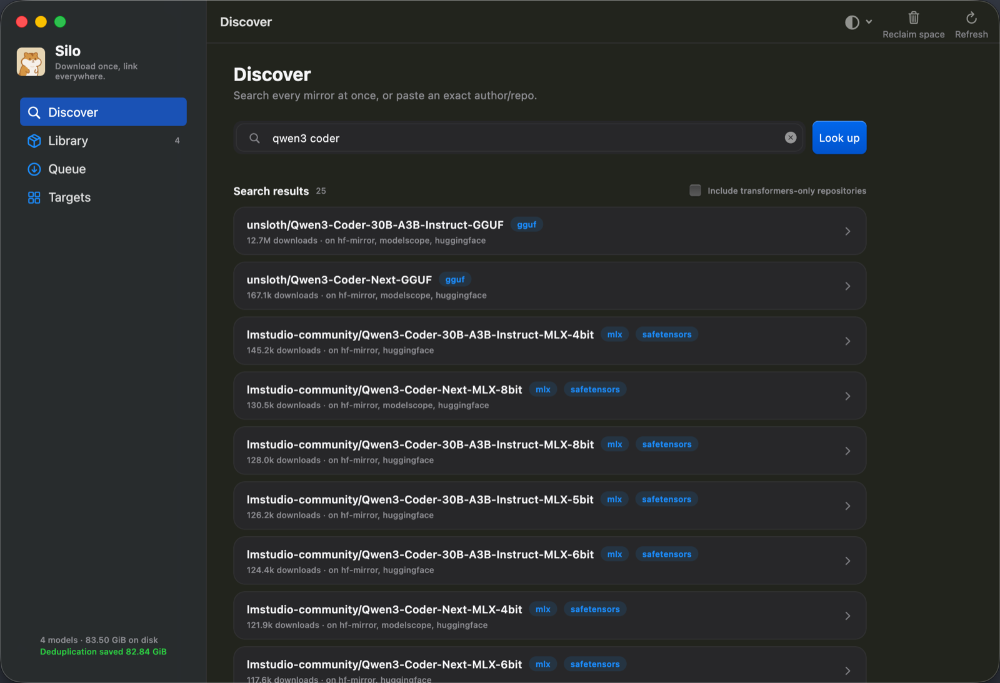
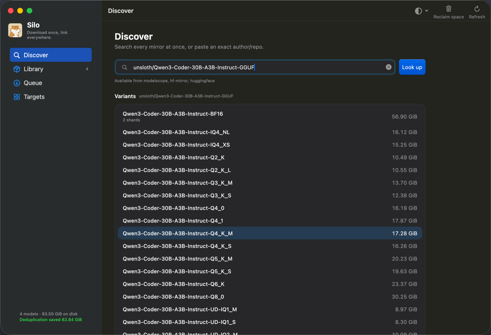
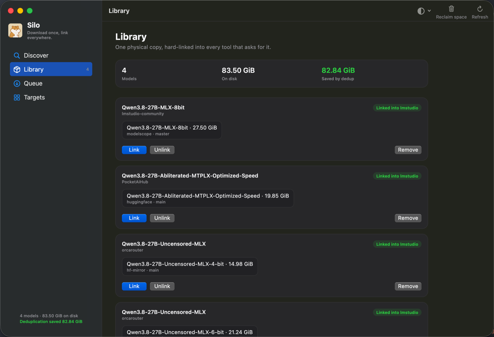

<p align="center">
  
</p>

<h1 align="center">Silo</h1>

<p align="center">
  <b>macOS 上的本地模型库。下载一次，处处可用。</b>
</p>

<p align="center">
  <a href="https://github.com/LinXunFeng/"></a>
  <a href="https://github.com/LinXunFeng/silo/releases/latest"></a>
  <a href="https://github.com/LinXunFeng/silo"></a>
  
</p>

Language: 中文 | [English](README.md)

每个本地 AI 应用都有自己的模型目录，同一个模型装了几个应用就要在磁盘上存几份。
Silo 让每个模型**只存一份**，再链接给所有用到它的工具：一个 5 GB 的模型，不管几个
工具在用，都只占 5 GB。

找模型、下模型也一并省心：一个搜索框搜遍 HuggingFace 和它的镜像，自动挑最快的
镜像，断网了也能接着下。

## ☕ 请我喝一杯咖啡

[](https://ko-fi.com/T6T4JKVRP) [](https://cdn.jsdelivr.net/gh/FullStackAction/PicBed@resource20220417121922/image/202303181116760.jpeg) [](https://github.com/sponsors/LinXunFeng)

微信技术交流群请看: [【微信群说明】](https://mp.weixin.qq.com/s/JBbMstn0qW6M71hh-BRKzw)

## 📸 截图

<table>
  <tr>
    <td width="33%"></td>
    <td width="33%"></td>
    <td width="33%"></td>
  </tr>
  <tr>
    <td align="center"><b>发现</b><br/>一次搜遍所有源</td>
    <td align="center"><b>变体</b><br/>一个模型的所有量化版本及体积</td>
    <td align="center"><b>模型库</b><br/>有哪些模型、链接到了哪里、省了多少空间</td>
  </tr>
</table>

## ✨ 特点

- 💾 **只存一份，所有工具共用。** 每个模型只在磁盘上存一份，再共享给每个用到它的
  工具。没有重复占用，工具那边也察觉不到区别。
- 🔍 **一个搜索框搞定。** 同时搜索 HuggingFace 和 ModelScope，或者直接
  粘贴 `author/repo`，列出所有量化版本和体积。
- ⚡ **实测最快的镜像。** 下载前先测速再选镜像，某个镜像下载失败会自动换下一个。
- 🔁 **下载不怕中断。** 暂停、退出、重启电脑之后都能接着下，每个文件下完都会校验。
- 🧩 **模型不会被拆散。** 分片权重和视觉模型需要的附加文件会归成一个条目。
- 🖥 **应用和命令行都有。** 原生 macOS 应用和 `silo` 命令共用同一个模型库。

## 🎀 支持

| 下载源 | 链接到 |
| --- | --- |
| ✅ HuggingFace | ✅ LM Studio |
| ✅ hf-mirror | ✅ Draw Things |
| ✅ ModelScope | 🚧 Ollama |
| ✅ 自定义端点 | 🚧 llama.cpp |
| | 🚧 ComfyUI |
| | 🚧 HuggingFace 缓存 (transformers / vLLM) |

## 📦 安装

使用 [Homebrew](https://brew.sh)：

```bash
brew tap linxunfeng/tap
brew install --cask linxunfeng/tap/silo   # 应用
brew install linxunfeng/tap/silo          # 命令行
```

<details>
<summary>手动下载</summary>

到 [Releases](https://github.com/LinXunFeng/silo/releases/latest) 下载 `.dmg`（应用），
或对应架构的 `.tar.gz`（命令行，`uname -m` 可以查看架构）。

产物没有经过公证，首次打开会被 macOS 拦下，去掉隔离属性即可：

```bash
# 应用：先把 Silo 拖进「应用程序」
xattr -dr com.apple.quarantine /Applications/Silo.app

# 命令行
tar -xzf silo-*-macos-$(uname -m).tar.gz
xattr -d com.apple.quarantine silo 2>/dev/null || true
mv silo ~/bin/silo   # 或 PATH 中的任意目录
```

用 Homebrew 安装会自动处理这一步。

</details>

## 🚀 快速上手

**应用：** 先在「分发目标」里打开你在用的工具，然后用关键字或 `author/repo` 搜索模型，选一个版本下载，下完会自动链接到这些工具。

**命令行：**

```bash
silo search qwen3 coder                      # 搜索模型
silo add Qwen/Qwen2.5-0.5B-Instruct-GGUF     # 下载并链接到 LM Studio
silo ls                                      # 查看模型库和省下的空间
```

<details>
<summary>更多命令</summary>

```bash
silo inspect <author/repo>              # 查看仓库里的可选版本
silo inspect <author/repo> --files      # 列出仓库里的每个文件和大小
silo add <repo> --file <path>           # 只下载其中一个文件，比如某一个 checkpoint
silo sources --probe <author/repo>      # 测一下此刻哪个镜像最快
silo add <repo> <repo> ...              # 一次添加多个，排队逐个下载
silo queue --resume                     # Ctrl-C 之后继续下载
silo add <repo> --to drawthings         # 把图像模型或 LoRA 送进 Draw Things
silo scan                               # 查看各工具里已有的模型
silo unlink <repo> --from lmstudio      # 从某个工具移除，但保留在库里
silo rm <repo>                          # 从库里移除
silo gc                                 # 回收磁盘空间
```

全局参数：`-j 8` 连接数、`--limit 5M` 限速、`--source modelscope` 指定镜像、
`--store <dir>` 更换模型库位置。完整列表见 `silo help`。

</details>

## 🛠 开发

架构、从源码编译和发版流程见 [docs/development.md](docs/development.md)（英文）。

## 📄 开源协议

[Apache License 2.0](LICENSE) © 2026 LinXunFeng

## 🖨 关于我

- GitHub: [https://github.com/LinXunFeng](https://github.com/LinXunFeng)
- Email: [linxunfeng@yeah.net](mailto:linxunfeng@yeah.net)
- 博客: 
  - 全栈行动: [https://fullstackaction.com](https://fullstackaction.com)
  - 掘金: [https://juejin.cn/user/1820446984512392](https://juejin.cn/user/1820446984512392) 


